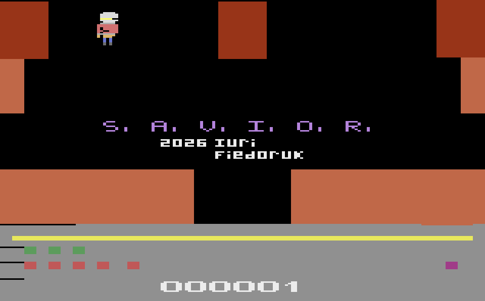
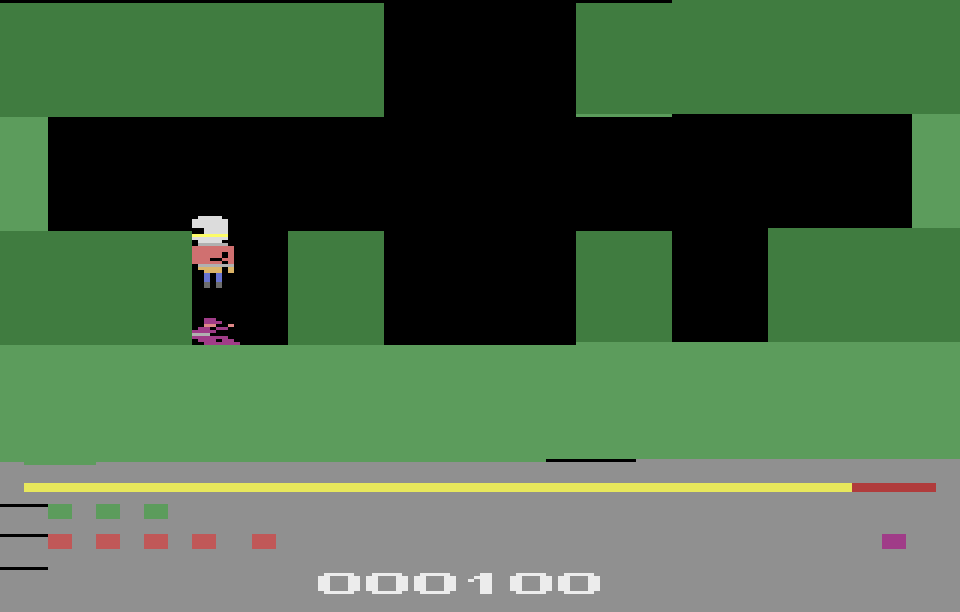
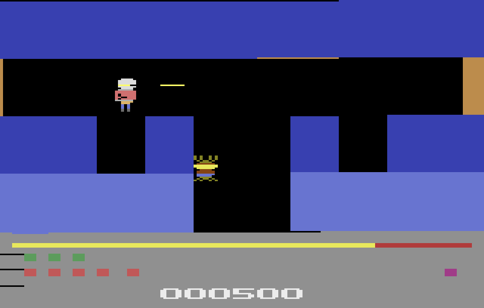
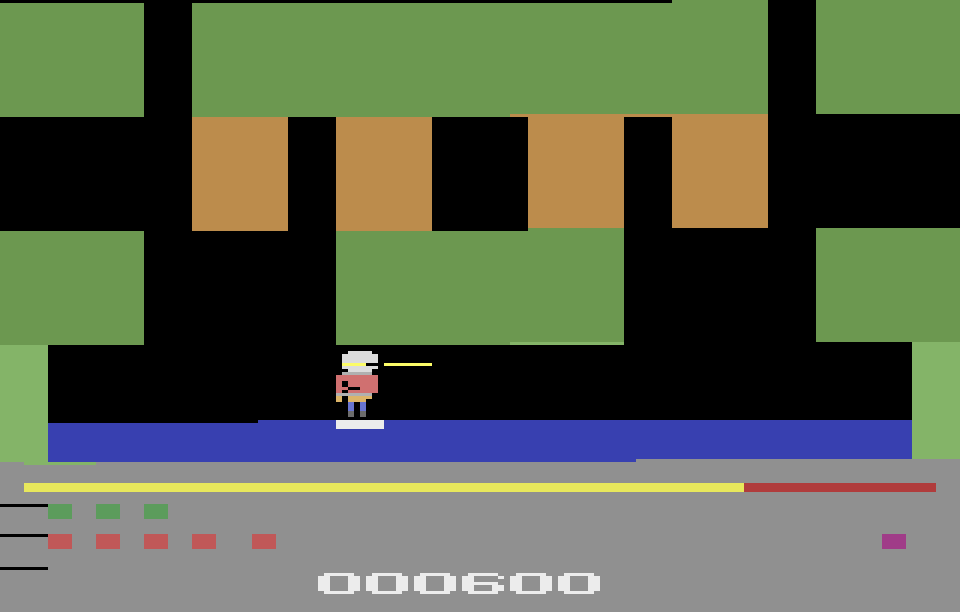
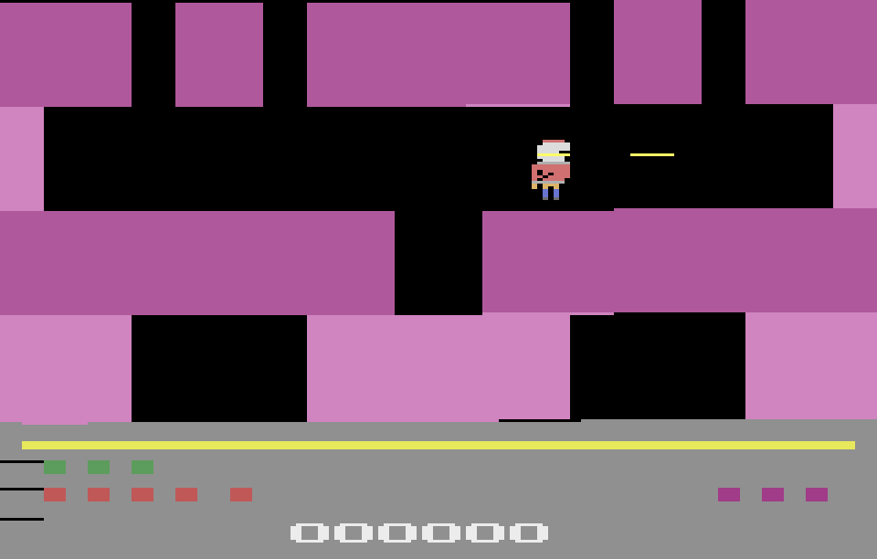

# S.A.V.I.O.R. 1.0.0

**A cave-rescue game for the Atari 2600.** Strap on the jet pack, point the helmet laser
and bring every miner home.

*Eorley Savior founded the S.A.V.I.O.R. company (Strategic Aerial Vehicle Infiltration
Operations Rescue) to save people trapped in the deep mines of Minas Gerais, Brazil.
You are Eorley, and the clock is running.*

## The game

Twenty levels, each a network of mirrored cave rooms. Fly from room to room with a
rocket-powered jet pack, find the trapped miners (up to three per level) and touch
them before the power bar runs dry. Shoot creatures with the helmet laser, blow open
thin walls with bombs, grab power cells to refill the timer, and mind the hazards:
hot rock, phase walls that blink, crushers that sweep across a whole band, and flooded
rooms where the only way across is a ferry raft that moves only while you stand on it.

Rescue them all and the level pays a bonus for the time left, every unused bomb and
double for every life you keep. Then the next, more dangerous cave opens, and the
creatures get faster every five levels.

**Features**
- 20 levels generated by the project's own stage generator, every one checked for a
  finishable route and played through on the real ROM by a joystick-only bot.
- Spiders, bats, snakes, tentacles and giant moths; hot rock, phase walls, crushers,
  locked doors and keys, lamps that plunge a room into darkness, bombs, power cells.
- Up to three miners per level, up to eight lives, an extra life every 50,000 points,
  scores up to 999,999.
- **SaveKey / AtariVox support** (right controller port): your high score, and the
  level, lives and score at the start of every level. The title opens on your saved
  level and RESET carries on; a game over erases the save but never the high score.
- Illustrated 13-page instruction manual (PDF).
- Plays on a standard Atari 2600 with a joystick (F4 bank-switched 32 KB ROM, NTSC).

*Level 3: the miner waits at the bottom of the shaft. The bar at the bottom is the
power left; the squares are your lives (green), bombs (red) and miners still to rescue
(purple).*

*Level 9: a spider hangs in the shaft and the helmet laser is firing. Creatures speed up
every five levels.*

*Level 11: a flooded room under a hot-rock ceiling. The only way across is the ferry raft
under your feet; touching the water costs a life.*

*Level 14: a crusher sweeps across the middle band, leaving a moving gap. Its sides are
deadly, but you can land on it or bump your head under it.*

## What changed since 0.8

0.8 (build 36) was the last internal beta. Since then:

**New**
- **SaveKey / AtariVox support**: high score, level, lives and score; the title shows the
  saved level and alternates the level number with the high score.
- **Real game over**: running out of lives (or clearing level 20) ends the run, saves the
  high score and returns to the title.
- **Eight lives and extra lives**: one every 50,000 points; the HUD shows up to eight
  squares; the score goes up to 999,999.
- **The key is a ball** on the lives row (the way HERO draws its HUD indicators).
- **Crushers can be stood on**: land on a closed crusher or touch it from below; its
  sides still kill.
- **A story and a full instruction manual**: Eorley Savior, the company and the mines of
  Minas Gerais, with a manual page for saving.
- **Version stamp**: the ROM carries "S.A.V.I.O.R. 1.0.0" in its header.

**Smarter level generator**
- Phase walls are horizontal obstacles only; crushers appear in the band that suits the
  way you enter the room and never in rooms you enter from the side.
- Spiders and moths start in the direction away from walls and the screen edge (a spider
  that faces left sweeps up first, one that faces right sweeps down first).
- No enemy is ever drawn half inside a wall (the snake, which lives in walls, excepted).
- Rafts wait under the shaft you drop through, at the height of the water.

**Fixed**
- **Boot on real hardware**: a 32 KB F4 cartridge can power up in any of its eight banks.
  Two banks had no boot stub; now all eight select the game bank first (new test boots
  from every bank).
- **Raft turn-around** read the wrong playfield row after the four-band move, so rafts
  turned at ledges that were not in their way.
- **Start spawn** straddled two cells and could drop you into a wall in some start rooms.
- **Flicker**: the overscan governor drops extra enemy passes on frames that would
  overrun, and the level banner no longer lengthens the frame on level 20.
- **HUD**: the lives squares keep an exact 8-pixel pitch from the first to the eighth,
  and a new test measures their pixel positions and the key ball's.

**Tools**
- The level editor draws the real sprites, lets you drag enemies, lamps and the miner
  with wall snapping, and sets facing with the toolbar button.
- `tools/playbot.py` plays all 20 levels on the real ROM; `tools/release.py` builds,
  gates and stamps a release; 83 automated tests guard the ROM and the generator.

## Credits

Written from scratch by Iuri Fiedoruk. Inspired by H.E.R.O. (Activision, 1984); thanks to
Andrew Davie for the positioning routines, to Felipe Zacani for the ideas of multiple
miners, doors and keys, and to the Atari 2600 community. Tested in the Stella emulator.
